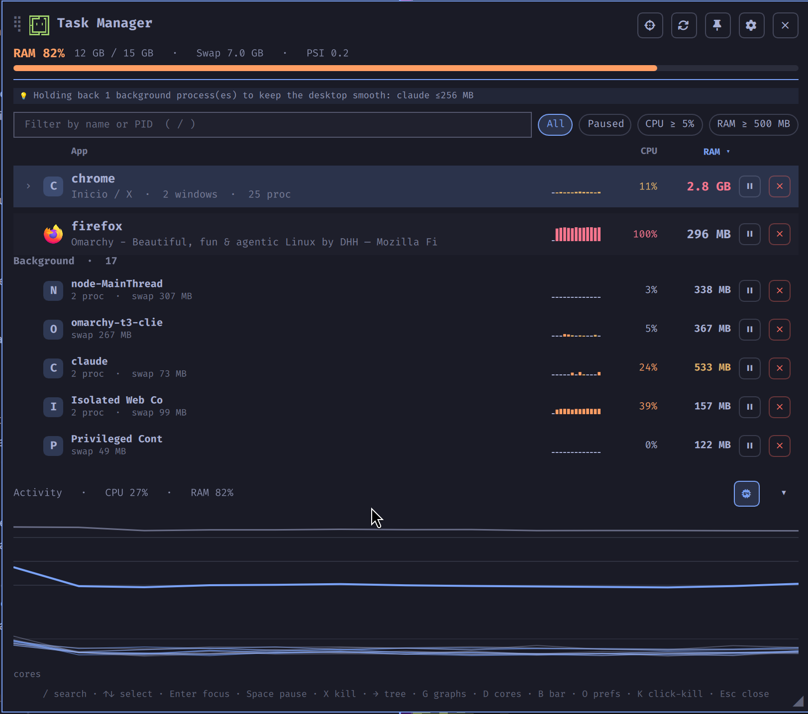

# Task Manager



Your Omarchy bar gains a kill switch for RAM hogs. When memory runs out,
apps freeze in place — greyed out, under the watchful eye of a blinking Omi —
while the kernel squeezes their idle pages into compressed RAM. Click, and
they come back like nothing happened.

## The fun parts

- **Pause any app, right on its window.** One click (or `Space`) freezes a
  whole app family: grey veil, blinking mascot, the app's name in big
  letters on a green badge. CPU drops to zero on the spot.
- **It watches while you don't.** A tiny Rust daemon (~500 KB) reads memory
  pressure every two seconds and auto-pauses the greediest apps before the
  desktop seizes up. You get a notification, not a lockup.
- **Frozen apps hand their RAM back.** While frozen, a temporary
  `memory.high` cap lets the kernel reclaim the app's cold pages — and with
  zswap on, they're compressed in RAM (~2-3x) instead of touching disk.
  That's the trick: paused apps stop costing you memory, not just CPU.
- **You set the limits.** Gear → max RAM% before the watchdog bites,
  optional CPU ceiling, bar display, sparklines. Sane defaults, your call.
- **Hunt single browser tabs.** Expand any app's process tree and pause or
  kill one renderer — that one tab eating 2 GB — while the rest of the
  browser never notices.
- **No fake "not responding" dialogs.** Hyprland's ANR popup is silenced
  exactly while a pause is ours, and restored the moment nothing is frozen.
- **Real numbers, live.** Bar pill (icon / numbers / numbers + graphs),
  per-row sparklines, full CPU/RAM history with per-core detail, and a
  System section showing what the daemons are up to.
- **Keyboard first.** `↑↓` select, `Enter` focus, `Space` pause, `X` kill,
  `→` tree, `G` graphs, `D` cores, `B` bar mode, `R` refresh, `Esc` close.
  A legend line at the bottom of the card lists them all.
- **Speaks your language.** EN, ES, PT, FR, DE, following your Omarchy
  locale.

## How the pause works (no root, no magic)

Omarchy apps run in systemd user scopes on cgroup v2. Freezing sets
`cgroup.freeze=1` (a SIGSTOP fallback covers strays), so a paused app burns
exactly 0 CPU. RAM reclaim is the kernel's own machinery — `memory.high`
plus zswap — and thaw restores everything in place. The session never asks
for sudo, and kill always thaws first (frozen processes can't handle
SIGTERM).

## Install

```sh
curl -fsSL https://raw.githubusercontent.com/avillagran/omarchy-task-manager/main/install.sh | bash
```

Uninstall just as cleanly — watchdog stopped, everything thawed, unit
removed, your config untouched:

```sh
curl -fsSL https://raw.githubusercontent.com/avillagran/omarchy-task-manager/main/install.sh | bash -s -- --uninstall
```

Comes bundled with the
[Omarchy Control Panel](https://github.com/avillagran/omarchy-control-panel),
which installs it on by default. It stays a standalone plugin: Control
Panel > Task Manager turns it off (`bash install.sh --disable`: watchdog
stopped, paused apps thawed, widget hidden, config kept) and back on
(`--enable`).

## Shortcut

Nothing touches your keybinds without asking. Open the card, hit the gear,
and flip **Show window shortcut** on: that's `SUPER+SHIFT+T`. Same switch
turns it off.

## Memory governor

The watchdog's freeze is the last resort. Before that point, the governor
(part of the same `watch` daemon, every 2s) keeps the desktop fluid the
way macOS does, using cgroup v2 knobs on the user's own delegated subtree
(no root):

| Level | When | What |
|---|---|---|
| calm | ≥ 30% RAM available | limits loosen gradually, then are removed |
| elevated | < 25% available (or stalls with < 33%) | windowless scopes (agents, builds, test runners) get a `memory.high` a few % below their size each tick, so they reclaim their own pages and slow down instead of evicting your apps; windowed apps unfocused for 2+ min hand cold pages to zram in small `memory.reclaim` chunks |
| critical | < 12% available | the same, harder; windowless services are limited too |

Never touched: the session (Hyprland, the shell), audio, the focused app,
anything frozen. A limited group that stalls on its own memory gets its
limit loosened, never squeezed into a livelock. Every limit is restored when
pressure clears, on daemon restart, and on `--disable`/`--uninstall`
(`task-manager governor-release`). The card lists what is being held back.
Off switch: `task-manager pref governor 0`.

## tmpfs hygiene

`/tmp` and `$XDG_RUNTIME_DIR` live in RAM: a file there stays in memory (or
swap) until deleted, and no reclaim can drop it. The daemon removes logs of
dead quickshell instances automatically, and suggests deleting `/tmp` trees
of yours that nothing touched for 24 h and no process holds open
(`task-manager clean-tmp list` shows them, `clean-tmp` deletes them).

## zswap vs zram

Omarchy swaps to zram (compressed RAM). Do **not** enable zswap on top of
it: every page gets compressed twice, writeback allocations fail under
pressure, and reclaim gets slower. If an older version of this README made
you create `/etc/tmpfiles.d/zswap.conf`, the card flags it and copies the fix:

```sh
sudo sh -c 'echo N > /sys/module/zswap/parameters/enabled; rm -f /etc/tmpfiles.d/zswap.conf'
```

Only on a machine whose swap is a plain disk (no zram) is zswap worth it;
the card then offers the enable command instead.

## Browser tab titles (optional bridge)

Chrome/Chromium/Brave expanded rows can list **every open tab** (title, not
just the active one per window). The OS cannot provide this — nothing in
`/proc` maps a renderer pid to a tab — so the data comes from a tiny
companion extension, over Chrome's Native Messaging, 100% local:

- `install.sh` registers the native host **user-scoped** (no root) for
  every browser profile dir it finds. Safe to re-run; unregistered by
  `install.sh --uninstall`.
- Load the extension once, either way:
  - **Direct (no store, no developer account):**
    `bin/task-manager-bridge-install.sh auto` writes ONE system file
    (`/opt/google/chrome/extensions/<id>.json`, via sudo) pointing at the
    self-hosted update manifest on GitHub Releases. Restart Chrome once —
    the extension installs itself and auto-updates on every release.
    `auto-uninstall` removes it.
  - **Fully rootless:** `chrome://extensions` → Developer mode →
    **Load unpacked** → `bridge-extension/source`.
  From then on the expanded browser row shows all tabs (active marked ▸),
  refreshing live.
- The extension is read-only (permissions: `tabs` + `nativeMessaging`),
  never touches page content, and writes only to
  `~/.cache/omarchy/task-manager/tabs.json` (mode 0600).
- A store-ready package is included: `bridge-extension/omarchy-task-manager-tabs.cws.zip`.
  Uploading it to the Chrome Web Store (unlisted listing is fine) turns
  the extension step into a one-click install; the manifest's fixed `key`
  keeps the extension ID stable, so the native host registration keeps
  working unchanged.

## Development note: `import QtQuick 6.11`

Every QML file imports `QtQuick 6.11` (and `QtQuick.Window 6.11`), never the
unversioned module. Qt 6.12 added a `QtQuick` `Color` singleton that shadows
`Color` from Omarchy's `qs.Commons`, leaving theme colors `undefined`
(white surfaces, black text, `Cannot read property 'background' of
undefined`). An unversioned `import QtQuick.Window` re-imports the latest
QtQuick and brings the problem back. New files must use the pinned import.

## Layout

    manifest.json
    BarWidget.qml                  bar pill + overlay card + veils
    i18n.json                      EN/ES/PT/FR/DE
    install.sh                     idempotent installer (--uninstall)
    systemd/omarchy-task-manager.service   watchdog unit template
    bin/task-manager-launch.sh     arch launcher
    bin/task-manager-keybind.sh    opt-in shortcut manager
    bin/task-manager-aarch64       prebuilt helper (ARM/Asahi)
    bin/task-manager-x86_64        prebuilt helper (Intel/AMD)
    bin/task-manager-rs/           Rust crate (cargo build --release)

## Resource cost (measured)

- Helper: ~5 ms per state call, ~500 KB binary. Watchdog: 2 reads/500 ms.
- Bar poll: 15 s idle, 2 s while the card is open or any app is paused.

## Credits

- **Omi**, the mascot blinking over your paused apps, was an idea by
  [@tahayvr](https://github.com/tahayvr). The vector path comes from the
  official Omarchy brand assets.

## Roadmap

- Marketplace submission.
